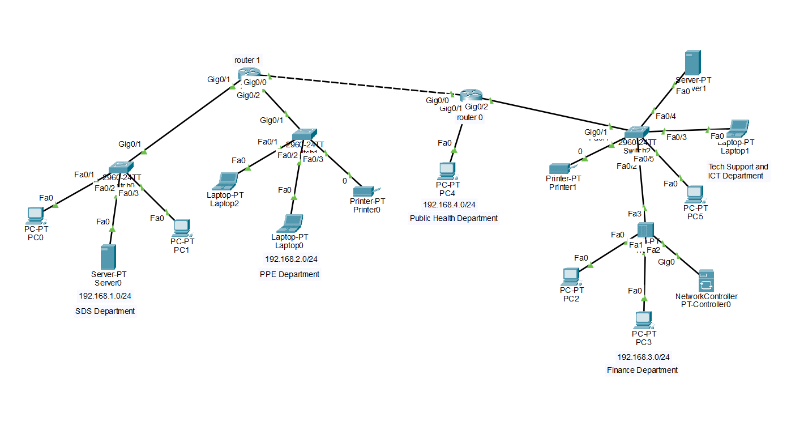

# University Network Simulation

A multi-department Cisco Packet Tracer network simulation demonstrating static routing between two core routers (`Router0` and `Router1`) and multiple local department subnets.

## Network Topology

## Department Subnets
| Department | Subnet | Gateway / Interface |
| :--- | :--- | :--- |
| **SDS Department** | `192.168.1.0/24` | `192.168.1.1` (Router1, Gi0/1)[cite: 4] |
| **PPE Department** | `192.168.2.0/24` | `192.168.2.1` (Router1, Gi0/2)[cite: 4] |
| **Finance Department** | `192.168.3.0/24` | `192.168.3.1` (Router0, Gi0/2)[cite: 5] |
| **Public Health Department** | `192.168.4.0/24` | `192.168.4.1` (Router0, Gi0/1)[cite: 5] |
| **Inter-Router Link** | `10.0.0.0/30` | `10.0.0.1` (Router1) / `10.0.0.2` (Router0)[cite: 4, 5] |

## Configuration
* **Static Routing:** Configured static routes on `Router1` to reach Router0 subnets (`192.168.3.0/24` and `192.168.4.0/24`) via next-hop `10.0.0.2`.
* **Reverse Routing:** Configured static routes on `Router0` to reach Router1 subnets (`192.168.1.0/24` and `192.168.2.0/24`) via next-hop `10.0.0.1`.
* **Devices:** Includes Cisco 2911 routers, 2960 switches, servers, PCs, laptops, and printers distributed across localized department segments[cite: 3, 4, 5].

## How to Use
1. Download and open `network_typology_university.pkt` in Cisco Packet Tracer.
2. Click on either `Router0` or `Router1`, navigate to the **CLI** tab, and enter `show ip route` to view active static routes.
3. Test end-to-end connectivity by opening the Command Prompt on any PC (e.g., PC0 in SDS) and pinging a device on the opposite router (e.g., `ping 192.168.4.2`).
